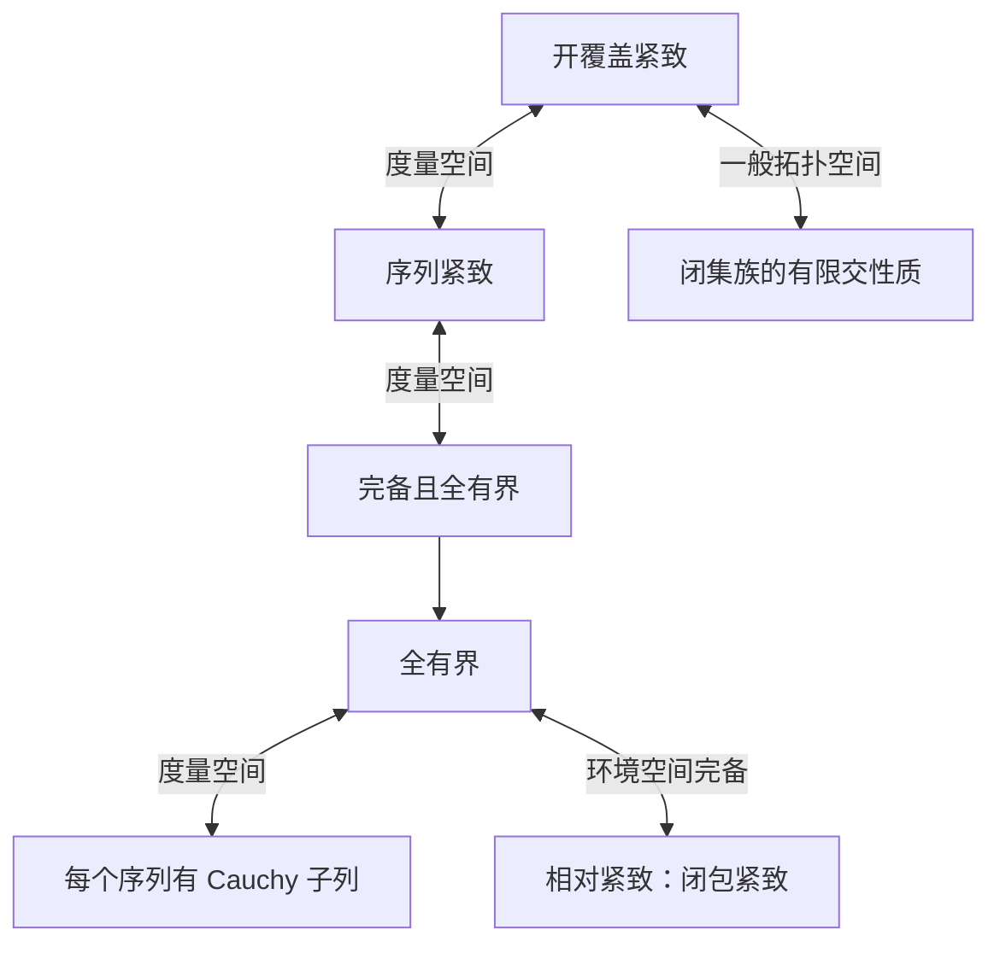
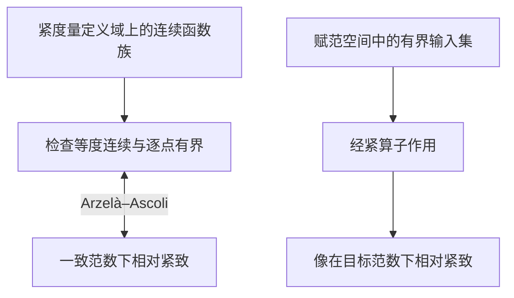
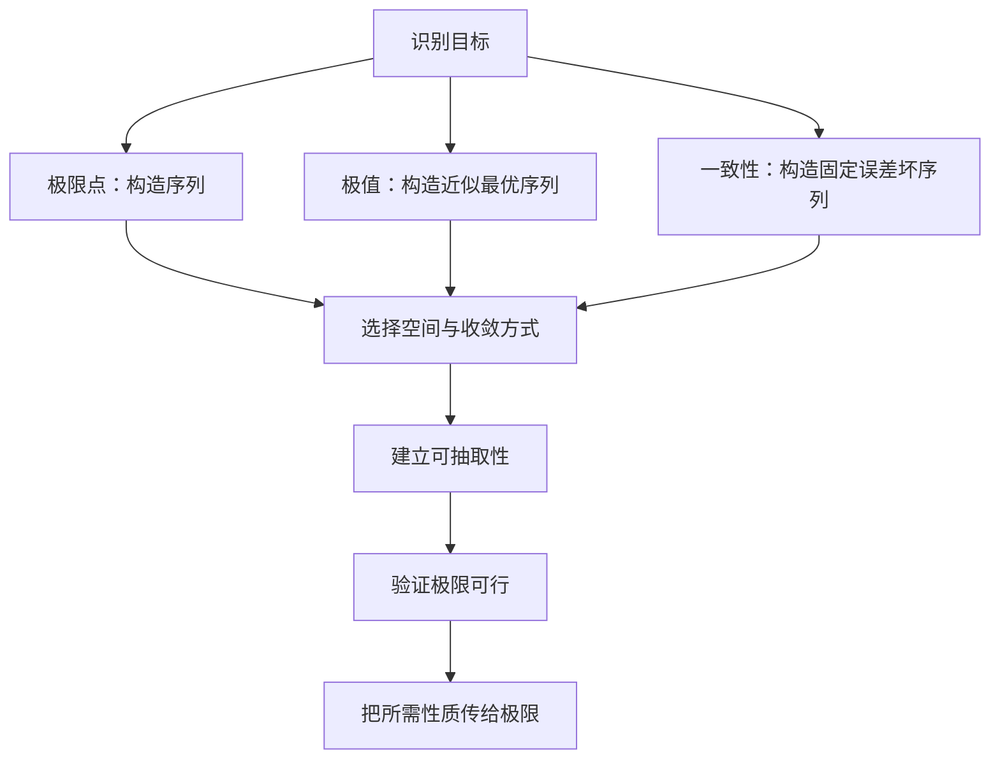

紧致性、极值与收敛子列：从 Bolzano–Weierstrass 定理到现代分析学
如果一个对象只能被越来越好地逼近，怎样证明它真正存在？

构造逼近序列 → 抽取收敛子列 → 确认极限可行 → 把逼近性质传给极限。

第1—7章建立数学分析和度量空间主线，第8—10章拓展到函数空间、泛函分析与存在性问题，第11—15章汇集反例、考试例题、十八道习题及解答和知识体系。

记 \((X,d)\) 为度量空间，\(B_X(x,r)\) 为相对开球，\(K\subset X\) 带子空间结构。讨论极值时默认定义域非空。
第1章　从有界性到收敛子列
1.1　子列、聚点与整个数列的收敛
定义1.1（子列与聚点）　子列 \((x_{n_k})\) 的指标满足 \(n_1<n_2<\cdots\)。若某个子列收敛于 \(x\)，称 \(x\) 为数列 \((x_n)\) 的聚点。这等价于对每个 \(r>0\) 和每个 \(N\)，都存在 \(n\ge N\) 使 \(x_n\in B_X(x,r)\)。

证明。 若有收敛子列，取其足够靠后的项即可。反之，可递归选 \(n_k>n_{k-1}\) 且 \(d(x_{n_k},x)<1/k\)，故 \(x_{n_k}\to x\)。

数列聚点与值域集合的导点有区别。例如常数列 \(x_n=a\) 的聚点是 \(a\)，而单点集 \(\{a\}\) 没有导点。
数列	聚点集合
\(x_n=n\)	空集
\(x_n=1/n\)	\(\{0\}\)
\(x_n=(-1)^n\)	\(\{-1,1\}\)
依次拼接 \(0,1\)，\(0,1,1/2\)，\(0,1,1/2,1/3\) 等	\(\{0\}\cup\{1/m:m\ge1\}\)
枚举 \(\mathbb Q\cap[0,1]\)	\([0,1]\)

最后一行成立，因为每个非空相对开区间都有无穷多个有理数。第四行中每个列出的值出现无穷多次，而整个值域已闭，所以没有其他聚点。

命题1.2（聚点集合闭）　度量空间中，数列的全部聚点组成闭集。

证明。 设聚点 \(y_j\to y\)。对每个 \(k\) 先选 \(j_k\) 使 \(d(y_{j_k},y)<1/(2k)\)，再选 \(n_k>n_{k-1}\) 使 \(d(x_{n_k},y_{j_k})<1/(2k)\)。由三角不等式，\(d(x_{n_k},y)<1/k\)，故 \(y\) 也是聚点。

在存在性证明中，一个合适的收敛子列就可能产生所需对象。它仍保留原序列已有的极限关系及逐项约束。例如若 \(f(x_n)\to M\)，就有 \(f(x_{n_k})\to M\)。整个数列收敛则更强。\((-1)^n+1/n\) 有分别趋于 \(1\) 和 \(-1\) 的子列，数列自身振荡。甚至聚点唯一也不足以推出收敛，取 \(x_{2n}=0\)、\(x_{2n-1}=n\) 即可。第6章将说明相对紧致性怎样排除这种逃逸。
1.2　闭区间套
定理1.3（闭区间套）　设非空闭区间 \(I_k=[a_k,b_k]\) 满足 \(I_{k+1}\subset I_k\)。则 \(\bigcap_k I_k\ne\varnothing\)。若 \(b_k-a_k\to0\)，交集恰为一点。

证明。 令 \(a=\sup_k a_k\)。嵌套性保证对每个 \(k\)，\(b_k\) 都是所有 \(a_j\) 的上界，所以 \(a_k\le a\le b_k\)。若 \(x,y\) 同属交集，则 \(|x-y|\le b_k-a_k\)，长度趋零时 \(x=y\)。

实数完备性在取上确界时保证交点存在，区间长度趋零保证交点唯一。若所有区间都等于 \([0,1]\)，交集就有多个点。
1.3　Bolzano–Weierstrass 定理
定理1.4　每个有界实数数列都有收敛子列。

引导。 如果有限分割中的每块只含有限多个数列项，整个区间还能包含任意靠后的数列项吗？

区间套证明。 将包含全部项的闭区间 \(I_0=[a,b]\) 二等分。至少有一半包含无穷多个指标对应的项，选为 \(I_1\)。递归得到 \(I_k\subset I_{k-1}\)，每个 \(I_k\) 都包含无穷多项，且长度为 \(2^{-k}(b-a)\)。由定理1.3取交点 \(x\)，递归选 \(n_k>n_{k-1}\) 使 \(x_{n_k}\in I_k\)。于是 \(|x_{n_k}-x|\le 2^{-k}(b-a)\to0\)。

这把有界性转化为逐尺度的有限定位，再用完备性得到极限。另一种证明见定理1.5之后。
1.4　单调子列定理
定理1.5　每个实数数列都有一个单调子列，允许非严格单调。

证明。 称 \(n\) 为峰指标，如果 \(x_n\ge x_m\) 对每个 \(m>n\) 成立。若峰指标无穷多，将它们按递增顺序排列，对应数值非增。若只有有限多个峰指标，从最后一个峰指标之后出发。每个这样的位置都存在值更大的后续位置，因此可递归构造严格递增子列。

定理1.4的第二个证明。 由定理1.5抽出单调子列。原数列有界，子列也有界，由单调有界定理收敛。实数完备性在单调有界定理中再次出现。

单调子列定理本身无需有界性。例如 \(x_n=n\) 已单调，却没有有限极限。考试中，若已知结论只对单调收敛列成立，可以先构造始终违反结论的子列，再将它规则化为单调子列。见例题2。
1.5　有限维中的逐坐标抽取
定理1.6　\(\mathbb R^n\) 中每个有界序列都有收敛子列。

证明。 写 \(x_m=(x_m^{(1)},\ldots,x_m^{(n)})\)。先抽出第一坐标收敛的子列，再从中抽出第二坐标收敛的子列。继续有限次，得到同一个子列 \(x_{m_k}\)，使 \(x_{m_k}^{(j)}\to a_j\) 对所有 \(1\le j\le n\) 成立。于是
\[
\|x_{m_k}-a\|_2^2=\sum_{j=1}^n|x_{m_k}^{(j)}-a_j|^2\to0.
\]
有限维性用在最后的有限和上。无限多个坐标分别收敛时，还需控制坐标尾部对范数的贡献。
1.6　Cauchy 子列与完备性
定义1.7　若对每个 \(\varepsilon>0\) 都存在 \(N\)，使 \(m,n\ge N\) 时 \(d(x_m,x_n)<\varepsilon\)，则 \((x_n)\) 是 Cauchy 数列。每个 Cauchy 数列都收敛到空间内的点时，空间称为完备。

命题1.8　收敛数列是 Cauchy 数列。Cauchy 数列若有子列趋于 \(x\)，则整个数列趋于 \(x\)。

证明。 第一条由三角不等式得到。第二条中，对给定 \(\varepsilon\) 取 \(N\) 使尾部两项距离小于 \(\varepsilon/2\)，再选 \(n_k\ge N\) 使 \(d(x_{n_k},x)<\varepsilon/2\)。于是对 \(n\ge N\) 有
\[
d(x_n,x)\le d(x_n,x_{n_k})+d(x_{n_k},x)<\varepsilon.
\]
完备性承接已经聚拢的数列。它本身不能让有界序列聚拢，例如 \(\ell^2\) 的标准基满足 \(\|e_n\|=1\)，但 \(\|e_n-e_m\|=\sqrt2\) 对 \(n\ne m\) 成立。
第2章　紧致性的几种面貌
2.1　开覆盖
定义2.1　若一族开集 \(\{U_\alpha\}\) 的并为 \(K\)，它构成 \(K\) 的开覆盖。若存在有限多个原覆盖成员，其并仍覆盖 \(K\)，称为有限子覆盖。每个开覆盖都有有限子覆盖的空间称为紧致空间。对 \(K\subset X\)，用环境空间开集覆盖 \(K\) 或用相对开集覆盖 \(K\) 是等价的。

有限集合紧致，因为每个点选一个覆盖成员即可。\((0,1)\) 的相对开集 \(U_m=(1/m,1)\)（\(m\ge2\)）构成开覆盖，任意有限并等于其中最大的成员，仍漏掉靠近 \(0\) 的点。
2.2　有限交性质
定理2.2　拓扑空间 \(K\) 紧致，当且仅当每族具有有限交性质的闭集都具有非空的全体交。有限交性质指每个有限子族的交非空。

证明。 取补集后，整个闭集族的交为空，等价于对应开集族覆盖 \(K\)。某个有限子族的交为空，等价于对应的有限子覆盖存在。由 De Morgan 律即得两种刻画等价。

因此紧空间中嵌套的非空闭集列有非空交集。直径趋零是唯一性交点的额外条件。
2.3　序列紧致性
定义2.3　若 \(K\) 中每个序列都有子列收敛到 \(K\) 中的点，则 \(K\) 序列紧致。

定理2.4　对度量空间，紧致与序列紧致等价。

证明。 若 \(K\) 紧致，给定 \((x_n)\subset K\)，令 \(F_N=\overline{\{x_n:n\ge N\}}^{\,K}\)。这些闭集非空、嵌套。取 \(x\in\bigcap_N F_N\)，便可递归选 \(n_k>n_{k-1}\) 且 \(d(x_{n_k},x)<1/k\)。

反向先建立两点。
1. 对每个 \(\varepsilon>0\)，\(K\) 可用有限个半径 \(\varepsilon\) 的球覆盖。否则可递归选 \(x_{n+1}\notin\bigcup_{j=1}^nB_K(x_j,\varepsilon)\)，得到两两距离至少为 \(\varepsilon\) 的序列，违背序列紧致性。
2. 任一开覆盖 \(\mathcal U\) 有一个 Lebesgue 数，具体指存在 \(\delta>0\)，使每个 \(B_K(x,\delta)\) 都包含于某个 \(U\in\mathcal U\)。否则，对每个 \(n\) 选 \(x_n\) 使 \(B_K(x_n,1/n)\) 不包含于任何覆盖成员。抽取 \(x_{n_k}\to x\)，选 \(U\) 含 \(x\)，并取 \(B_K(x,r)\subset U\)。当 \(d(x_{n_k},x)+1/n_k<r\) 时，\(B_K(x_{n_k},1/n_k)\subset U\)，矛盾。
用有限个半径 \(\delta/2\) 的球覆盖 \(K\)，再为每个球选一个包含它的原覆盖成员，即得有限子覆盖。

极限必须属于 \(K\)。例如 \((1/(n+1))\) 的所有子列在 \(\mathbb R\) 中都趋于 \(0\)，无法证明 \((0,1)\) 序列紧致。上述等价不能不加条件推广到任意拓扑空间。
2.4　全有界性与 Cauchy 子列
定义2.5　若对每个 \(\varepsilon>0\)，存在有限多个 \(a_j\in K\) 使 \(K=\bigcup_j B_K(a_j,\varepsilon)\)，称 \(K\) 全有界。这些中心组成有限 \(\varepsilon\)-网。

有界性只控制一个大尺度。全有界性要求每个小尺度都能有限定位。无限离散度量空间中，不同点的距离取 \(1\)，空间完备且有界，而半径 \(1/2\) 的球只能覆盖单点。

定理2.6　度量空间全有界，当且仅当每个序列都有 Cauchy 子列。

证明。 在半径 \(2^{-1}\) 的有限覆盖中选一球，保留其中无穷多个指标。再用半径 \(2^{-2}\) 的有限覆盖，在保留的指标中继续选一球，留下无穷多个指标。递归得到嵌套的无穷指标集 \(I_1\supset I_2\supset\cdots\)。选 \(n_j\in I_j\) 且递增。若 \(p,q\ge j\)，则二者对应的点同在半径 \(2^{-j}\) 的球内，因此距离小于 \(2^{1-j}\)。反之，不全有界时按定理2.4的贪心法构造固定尺度的分离序列。
2.5　完备且全有界
定理2.7　度量空间紧致，当且仅当完备且全有界。

证明。 紧致推出序列紧致，继而推出全有界。对任意 Cauchy 数列，先抽出收敛子列，再用命题1.8得到全列收敛，所以完备。反向由全有界性抽出 Cauchy 子列，由完备性得到空间内极限，再由定理2.4得到紧致。

全有界性负责找到聚拢的子列，完备性负责让聚拢过程在空间内结束。
2.6　Heine–Borel 定理
定理2.8　\(K\subset\mathbb R^n\) 紧致，当且仅当 \(K\) 闭且有界。

证明。 紧致蕴含全有界，故有界。若 \(x_m\in K\) 且 \(x_m\to x\in\mathbb R^n\)，可抽出子列趋于 \(y\in K\)。极限唯一性给出 \(x=y\)，故 \(K\) 闭。反之，若 \(K\) 闭且有界，任取 \((x_m)\subset K\)。由有限维 Bolzano–Weierstrass 抽取收敛子列，闭性保证极限仍在 \(K\)，所以 \(K\) 紧致。

有限维中，有界集可以装入大立方体，再分成有限多个任意小的立方体，因此有界性蕴含全有界性。一般度量空间缺少这一保证。
集合	紧致性	原因
\([0,1]\)	紧致	闭且有界
\((0,1)\)	不紧致	缺失边界极限
\([0,\infty)\)	不紧致	序列 \(n\) 无收敛子列
\(\mathbb R^n\)（\(n\ge1\)）	不紧致	无界

2.7　相对紧致性与刻画总表
定义2.9　若 \(\overline A^{\,X}\) 紧致，则称 \(A\subset X\) 相对紧致。在度量空间中，这等价于 \(A\) 中每个序列有一个子列收敛于 \(X\) 中的点。

证明。 正向由紧闭包的序列紧致性得到。反向给定 \(y_n\in\overline A\)，选 \(a_n\in A\) 使 \(d(a_n,y_n)<1/n\)。抽取 \(a_{n_k}\to y\in X\)，则 \(y\in\overline A\) 且 \(y_{n_k}\to y\)。因此闭包序列紧致。

若环境空间完备，全有界等价于相对紧致。全有界传给闭包，闭包在完备空间中完备，再用定理2.7。若 \(X=\mathbb Q\)，\(A=\mathbb Q\cap[0,1]\) 全有界，但逼近 \(\sqrt2/2\) 的有理序列在 \(X\) 中没有收敛子列。
刻画	适用范围	与紧致性的关系
每个开覆盖有有限子覆盖	任意拓扑空间	定义
闭集族有限交性质	任意拓扑空间	等价
每个序列有空间内的收敛子列	度量空间	等价
完备且全有界	度量空间	等价
闭且有界	有限维赋范空间	等价
闭且有界	无限维赋范空间	一般不足
全有界	完备环境空间中的子集	等价于相对紧致

可参阅 Robert Sharpley 的 Compactness in Metric Spaces。
第3章　连续性如何与紧致性合作
3.1　连续映射保持紧致性
定理3.1　若 \(K\) 紧致且 \(f:K\to Y\) 连续，则 \(f(K)\) 紧致。

证明。 设 \(\{V_\alpha\}\) 是 \(f(K)\) 的开覆盖。其原像构成 \(K\) 的开覆盖。取有限子覆盖 \(K=\bigcup_{j=1}^m f^{-1}(V_{\alpha_j})\)，则 \(f(K)=\bigcup_{j=1}^m V_{\alpha_j}\)。
3.2　连续实函数有界
定理3.2　紧致空间上的连续实函数有界。

开覆盖证明。 \(U_m=\{x:|f(x)|<m\}\) 是递增开覆盖。有限子覆盖中的最大指标 \(M\) 满足 \(K=U_M\)。

连续像证明。 \(f(K)\) 是实数中的紧集，故有界。

若 \(K\) 为度量空间，也可反证。无界会给出 \(|f(x_n)|>n\)。抽取 \(x_{n_k}\to x\in K\)，连续性迫使 \(f(x_{n_k})\to f(x)\)，矛盾。
3.3　Heine–Cantor 定理
定理3.3　若 \(K\) 为紧致度量空间、\(Y\) 为度量空间，则连续映射 \(f:K\to Y\) 一致连续。

引导。 一致连续失败时，能否找到两列越来越接近、像之间却始终保持固定距离的点？

证明。 若结论失败，存在 \(\varepsilon_0>0\) 和 \(x_n,y_n\) 满足 \(d(x_n,y_n)<1/n\) 且 \(d_Y(f(x_n),f(y_n))\ge\varepsilon_0\)。由紧致性抽取 \(x_{n_k}\to x\in K\)。三角不等式给出 \(y_{n_k}\to x\)，因此两列像都趋于 \(f(x)\)，矛盾。

紧致性让失败位置沿子列集中到一个点，局部连续性便足以控制它们。对 \(f(x)=x^2\) 在 \(\mathbb R\) 上，取 \(x_n=n\)、\(y_n=n+1/n\)，则输入距离为 \(1/n\)，输出距离为 \(2+1/n^2\)，失败位置逃向无穷远。
3.4　Dini 定理
定理3.4　设 \(K\) 紧致，\(f_n,f\in C(K,\mathbb R)\)。若 \(f_n(x)\uparrow f(x)\) 对每个 \(x\) 成立，则 \(f_n\to f\) 一致。单调递减情形同理。

证明。 固定 \(\varepsilon>0\)，令 \(g_n=f-f_n\)，\(U_n=\{g_n<\varepsilon\}\)。连续性保证 \(U_n\) 开，单调性保证递增，逐点收敛保证覆盖。取有限子覆盖并取最大指标 \(N\)，于是对 \(n\ge N\) 有 \(0\le g_n(x)\le g_N(x)<\varepsilon\) 对所有 \(x\) 成立。

连续性使误差条件在邻域稳定，单调性使满足条件的区域不缩小，紧致性使达到给定误差的时刻统一。\(x^n\) 在 \([0,1]\) 上单调逐点收敛，但极限只在 \(1\) 取值 \(1\)、其余为零。该不连续极限排除一致收敛。
第4章　极值存在：把上确界变成函数值
4.1　上确界与最大值
设 \(A=f(K)\)。\(M=\sup A\) 意味着所有 \(a\in A\) 满足 \(a\le M\)，且对每个 \(\varepsilon>0\)，有 \(a\in A\) 满足 \(a>M-\varepsilon\)。\(M=\max A\) 还要求 \(M\in A\)。\(f(x)=x\) 在 \((0,1)\) 上的上、下确界分别为 \(1,0\)，都不取得。最大值是一个数，最大值点可以有多个，例如常数函数的每一点都是最大值点。
4.2　Weierstrass 极值定理
定理4.1　非空紧空间上的连续实函数取得最大值和最小值。

证明一（连续像）。 \(A=f(K)\) 非空紧致，故在 \(\mathbb R\) 中闭且有界。取 \(a_n\in A\) 使 \(\sup A-1/n<a_n\le\sup A\)，则 \(a_n\to\sup A\)。闭性给出 \(\sup A\in A\)。下确界同理。

证明二（极大化序列，度量空间情形）。 令 \(M=\sup_K f\)。由定理3.2，\(M\) 有限。选 \(x_n\) 使 \(M-1/n<f(x_n)\le M\)。抽取 \(x_{n_k}\to x^*\in K\)。于是
\[
f(x^*)=\lim_k f(x_{n_k})=M.
\]
对 \(-f\) 作相同论证得到最小值。这个证明保留三个独立环节：目标值逼近、可行极限、目标值通过极限。
4.3　下半连续性
定义4.2　对度量空间中的实函数，下半连续指
\[
x_n\to x\quad\Longrightarrow\quad f(x)\le\liminf_n f(x_n),
\]
等价于所有子水平集 \(\{f\le c\}\) 闭。上半连续指 \(f(x)\ge\limsup_n f(x_n)\)，等价于 \(-f\) 下半连续。

等价性。 若序列不等式成立，则子水平集中任一收敛列的极限仍在该子水平集。反之，若不等式失败，在 \(f(x)\) 与 \(\liminf f(x_n)\) 之间选 \(c\)，则有无穷多项在闭集 \(\{f\le c\}\) 内，迫使 \(f(x)\le c\)，矛盾。

定理4.3　非空紧致度量空间上的实值下半连续函数有最小值，上半连续函数有最大值。

证明。 若 \(f\) 无下界，选 \(f(x_n)\le-n\)。抽取收敛子列后，下半连续性迫使有限的 \(f(x)\) 不大于 \(-\infty\)，矛盾。令 \(m=\inf_K f\)，取 \(f(x_n)\to m\) 并抽取 \(x_{n_k}\to x^*\in K\)。于是 \(m\le f(x^*)\le\liminf_k f(x_{n_k})=m\)。对 \(-f\) 应用同样结论即可处理最大值。
4.4　逆极值定理
定理4.4　对非空度量空间 \(X\)，以下等价：\(X\) 紧致，每个连续实函数都取得最大与最小值，每个连续实函数都有界。

证明。 前两条蕴含关系已知。若 \(X\) 非紧，取无收敛子列的序列 \((x_n)\)，定义
\[
g(x)=\inf_{n\ge1}\bigl(1/n+d(x,x_n)\bigr).
\]
三角不等式给出 \(g(x)\le g(y)+d(x,y)\)，交换 \(x,y\) 可知 \(g\) 为 \(1\)-Lipschitz。若 \(g(x)=0\)，选 \(n_j\) 使 \(1/n_j+d(x,x_{n_j})<1/j\)，则 \(n_j\to\infty\) 且 \(d(x,x_{n_j})\to0\)。再选严格递增指标即得到收敛子列，矛盾。因此 \(g>0\)，\(1/g\) 连续，却满足 \(1/g(x_n)\ge n\)。这与所有连续实函数有界矛盾。

对单个函数，有界与取得极值不同。对空间上全体连续实函数，两种性质在任意非空拓扑空间上等价。若所有连续实函数有界，给定 \(f\)，若 \(M=\sup f\) 不取得，则 \(1/(M-f)\) 连续且无界，矛盾。下确界同理。

一般拓扑空间中，这一性质不足以刻画紧致。取不可数集合 \(X\)，赋予余可数拓扑。任何两个非空开集相交，因此连续实函数只能是常数，否则两个不同函数值的不交开邻域会拉回为不交的非空开集。另一方面，取不同点 \(a_1,a_2,\ldots\)，则 \(U_n=X\setminus\{a_k:k\ge n\}\) 是没有有限子覆盖的开覆盖。故 \(X\) 不紧致。这说明度量空间的连续实函数具有更强的检测能力。
4.5　多元函数的极值位置
对非空闭有界 \(K\subset\mathbb R^n\)，\(f\in C(K)\) 的全局极值存在。寻找位置时分开讨论：
- 内部可微极值点满足 Fermat 条件 \(\nabla f=0\)。
- 边界点按边界各部分的约束求候选值。
- 对光滑等式约束 \(g_1=\cdots=g_m=0\)，若候选点约束梯度线性无关，则 \(\nabla f=\sum_j\lambda_j\nabla g_j\)。还要处理奇异点并比较候选值。
- 不可微点仍可能是极值点，如 \(|x|\) 在 \([-1,1]\) 上的极小点 \(0\)。
第5章　非紧致定义域上的极值
5.1　三种失败
以下函数均连续。
函数与定义域	上、下确界	是否取得	失败机制
\(x\)，\((0,1)\)	\(1,0\)	都不取得	靠近缺失的边界
\(x\)，\(\mathbb R\)	\(+\infty,-\infty\)（扩展实数）	都不取得	位置与函数值逃逸
\(e^{-x}\)，\([0,\infty)\)	\(1,0\)	最大值在 \(0\)，无最小值	极小化序列逃向无穷远

5.2　强制性
定义5.1　称 \(f:C\subset\mathbb R^n\to\mathbb R\) 在 \(C\) 上强制，如果对每个 \(M\in\mathbb R\)，存在 \(R\)，使 \(x\in C\) 且 \(\|x\|\ge R\) 时 \(f(x)>M\)。

定理5.2　若 \(C\) 非空且闭，\(f:C\to\mathbb R\) 下半连续且强制，则 \(f\) 取得最小值。

证明。 选 \(x_0\in C\)。子水平集 \(K=\{x\in C:f(x)\le f(x_0)\}\) 非空，由下半连续性及 \(C\) 闭可知 \(K\) 闭，由强制性可知 \(K\) 有界。因此 \(K\) 紧致，\(f\) 在其上有极小点 \(x^*\)。\(K\) 外的值大于 \(f(x_0)\ge f(x^*)\)，故 \(x^*\) 为全局极小点。
5.3　紧致子水平集
定理5.3　设 \(f:X\to\mathbb R\)。若某个 \(K_c=\{f\le c\}\) 非空紧致，且 \(f|_{K_c}\) 下半连续，则 \(f\) 在 \(X\) 上取得最小值。

证明。 \(K_c\) 上的最小值 \(m\le c\)，而其外的值大于 \(c\)。

如果已知极小化序列的尾部落在某个紧集内，也可在该紧集内抽取极限。目标是控制低值点的位置。
5.4　边界控制、无穷远控制与紧化
在有界开集上，\(\|x\|\to\infty\) 的条件可能真空成立，仍需控制边界。例如 \(1/x+1/(1-x)\) 在 \((0,1)\) 两端趋于 \(+\infty\)，所以低子水平集落在某个 \([\delta,1-\delta]\) 中，并且在该区间闭，故紧致。

若已找到紧集 \(K\) 与 \(x_0\in K\)，使 \(K\) 外的值都大于 \(f(x_0)\)，即可在 \(K\) 上求极小值。此法也适用于非强制函数，例如无穷远下极限严格大于某个实际函数值的情形。

紧化提供比较边界值的手段。把 \([0,\infty)\) 经 \(t=x/(1+x)\) 嵌入 \([0,1]\)，\(e^{-x}\) 可延拓为在 \(t=1\) 取零的连续函数。新增点承接了下确界，原问题仍无极小点。
第6章　紧致性证明的七种技术
6.1　极值逼近序列
取 \(f(x_n)\to m=\inf f\)，抽取 \(x_{n_k}\to x^*\)，再验证 \(x^*\) 可行以及 \(f(x^*)\le\liminf_k f(x_{n_k})\)。这两项分别控制约束与目标函数。极小化前还要确认 \(m\) 有限，或者先使用紧子水平集排除 \(m=-\infty\)。
6.2　反证与固定大小的失败
否定 \(a_n\to0\)，可取 \(\varepsilon_0>0\) 和子列使 \(|a_{n_k}|\ge\varepsilon_0\)。进一步抽取时，这个固定误差下界仍保留。

命题6.1　\(x_n\to x\) 当且仅当每个子列都有进一步子列趋于 \(x\)。

证明。 必要性显然。若原列不趋于 \(x\)，可取子列使 \(d(x_{n_k},x)\ge\varepsilon_0\)，其任何进一步子列都不趋于 \(x\)。

推论6.2　若值域相对紧致且聚点唯一为 \(x\)，则 \(x_n\to x\)。任取子列，相对紧致性使它有收敛子列，唯一性将极限指定为 \(x\)。
6.3　连续双射的逆连续
定理6.3　若 \(K\) 紧致、\(Y\) Hausdorff，且 \(f:K\to Y\) 连续双射，则 \(f^{-1}\) 连续。

证明。 闭集 \(F\subset K\) 紧致，其像紧致，因 \(Y\) Hausdorff 而闭。故 \(f\) 是闭映射，等价于逆映射连续。这里，紧集 \(L\subset Y\) 的闭性可通过如下方法得到：对每个 \(y\notin L\)，将 \(y\) 与 \(L\) 中各点用不交邻域分开，再用 \(L\) 的有限子覆盖，取 \(y\) 的对应有限个邻域之交。
6.4　有限覆盖
若每个 \(x\in K\) 有开邻域 \(U_x\)，其中 \(|f|\le M_x\)，有限子覆盖给出全局界 \(\max_j M_{x_j}\)。这个证明只用局部有界与紧致性。局部条件必须覆盖邻域内的点，仅在邻域中心成立无法作这样的拼接。
6.5　有限网
对具有共同连续模的函数族，给定误差先取适当半径的有限网。若 \(a_j\) 是靠近 \(x\) 的网点，则
\[
|f(x)-g(x)|
\le |f(x)-f(a_j)|+|f(a_j)-g(a_j)|+|g(a_j)-g(x)|.
\]
首尾由共同连续模控制，中项只需在有限多个网点上控制。
6.6　对角线抽取
依次抽取嵌套指标集 \(I_1\supset I_2\supset\cdots\)，第 \(j\) 层保证第 \(j\) 个收敛条件。选递增 \(n_k\in I_k\)。对固定 \(j\)，当 \(k\ge j\) 时 \(n_k\in I_j\)，所以对角子列满足第 \(j\) 个条件。从可数稠密集推到全域，还需共同估计。
6.7　完整例子：共同 Lipschitz 控制
设 \(f_n:[0,1]\to\mathbb R\) 满足 \(\|f_n\|_\infty\le M\) 和 \(|f_n(x)-f_n(y)|\le L|x-y|\)。枚举 \(D=\mathbb Q\cap[0,1]\)。对每个 \(q\in D\) 用 Bolzano–Weierstrass 并对角抽取，得到在每个 \(q\) 处收敛的同一子列。

若 \(L>0\)，给定 \(\varepsilon>0\)，取 \(D\) 中半径小于 \(\varepsilon/(3L)\) 的有限网。子列尾部在全部网点的两两差小于 \(\varepsilon/3\)，首尾两项也各小于 \(\varepsilon/3\)。由三项分解，该子列在一致范数中 Cauchy。完备性给出连续的一致极限。若 \(L=0\)，所有函数均常值，只需在一个点抽取。
第7章　紧致性如何控制极值点与边界
7.1　求极值前的四个问题
依次核查可行集非空、极小化序列能抽取、极限仍可行，以及目标函数在所用收敛下满足正确方向的不等式。在开集或无界集上，尤其要检查极限会不会离开可行集。
7.2　排除边界
设 \(\Omega\subset\mathbb R^n\) 为非空有界开集，\(f\in C(\overline\Omega)\)。若某个 \(x_0\in\Omega\) 满足 \(f(x_0)>\max_{\partial\Omega}f\)，则闭包上由紧致性取得的最大值不能在边界，只能在内部。若 \(f\) 在内部可微，才进一步使用 \(\nabla f=0\)。
7.3　近似极值点的稳定性
定理7.1　设 \(K\) 紧致度量，\(f\in C(K)\)，\(M=\max_K f\)，\(A=\{x\in K:f(x)=M\}\)。若 \(f(x_n)\to M\)，则 \(d(x_n,A)\to0\)。若 \(A=\{x^*\}\)，则 \(x_n\to x^*\)。

证明。 若距离不趋零，取距离至少为 \(\varepsilon_0>0\) 的子列，再抽取其中收敛于 \(x\in K\) 的子子列。连续性给出 \(f(x)=M\)，故 \(x\in A\)。但沿子子列 \(d(x_n,A)\le d(x_n,x)\to0\)，矛盾。
第8章　函数空间中的紧致性
8.1　无限维闭单位球
在 \(\ell^2\) 中，标准基 \(e_n\) 满足 \(\|e_n\|_2=1\)，而对 \(n\ne m\)，
\[
\|e_n-e_m\|_2^2=1+1=2.
\]
因此闭单位球有一个两两固定分离的序列，连 Cauchy 子列也没有。每个固定坐标却都有 \(e_n^{(j)}\to0\)。坐标逐个收敛允许范数集中到越来越靠后的坐标，有限维证明的最后一步在这里失效。
8.2　Riesz 引理
引理8.1　设 \(M\) 是赋范空间 \(X\) 的真闭线性子空间，\(0<\alpha<1\)。则存在单位向量 \(x\)，使 \(d(x,M)>\alpha\)。

证明。 取 \(z\notin M\)，令 \(\delta=d(z,M)>0\)。选 \(m_0\in M\) 使 \(\|z-m_0\|<\delta/\alpha\)，令 \(x=(z-m_0)/\|z-m_0\|\)。对任意 \(m\in M\)，
\[
\|x-m\|=\frac{\|z-(m_0+\|z-m_0\|m)\|}{\|z-m_0\|}
\ge\frac{\delta}{\|z-m_0\|}>\alpha.
\]
取下确界仍有 \(d(x,M)\ge\delta/\|z-m_0\|>\alpha\)。

定理8.2　赋范空间的闭单位球紧致，当且仅当空间有限维。

证明。 有限维情形由范数等价与 Heine–Borel 定理得到。无限维时，已有单位向量 \(x_1,\dots,x_n\) 的线性张成是有限维真闭子空间。用引理选到距该子空间大于 \(1/2\) 的新单位向量。递归得到两两距离大于 \(1/2\) 的序列，排除紧致性。
8.3　Arzelà–Ascoli 定理
定义8.3（等度连续）　函数族 \(\mathcal F\subset C(K)\) 在 \(x\) 等度连续，如果对每个 \(\varepsilon>0\)，存在 \(\delta>0\)，使所有 \(f\in\mathcal F\) 和所有满足 \(d(x,y)<\delta\) 的 \(y\) 都有 \(|f(x)-f(y)|<\varepsilon\)。对每个 \(x\) 成立则称函数族等度连续。

定理8.4　设 \(K\) 为紧致度量空间，\(\mathcal F\subset C(K,\mathbb R)\)。\(\mathcal F\) 在一致范数下相对紧致，当且仅当它等度连续且逐点有界。特别地，一致有界、等度连续的函数列有一致收敛子列。

充分性。 对每个 \(x\) 选 \(r_x\)，使 \(d(x,y)<r_x\) 时 \(|f(x)-f(y)|<\varepsilon/2\) 对全族成立。取由 \(B(x,r_x/2)\) 组成的有限覆盖，并令 \(\delta\) 为对应半径的最小值。若 \(d(y,z)<\delta\)，由包含 \(y\) 的一个覆盖球可知 \(y,z\) 都落在相应的较大球中，因此 \(|f(y)-f(z)|<\varepsilon\)，得到共同全局连续模。

对每个 \(m\) 取有限 \(1/m\)-网，取其并得到可数稠密集 \(D\)。给定任意序列 \((f_n)\subset\mathcal F\)，逐点有界性与对角抽取给出同一子列在 \(D\) 的每一点收敛。利用共同连续模选适当精度的有限网，网点可选在 \(D\) 中。子列尾部在网点上同时 Cauchy。由第6.5节的三项估计，子列在一致范数下 Cauchy，因 \(C(K)\) 完备而一致收敛。因此函数族相对紧致。

必要性。 紧闭包在一致范数下有界，故函数族一致有界。对给定 \(\varepsilon\)，取紧闭包中有限个函数 \(g_j\) 构成一致范数的 \(\varepsilon/3\)-网。它们在 \(K\) 上分别一致连续，取共同的 \(\delta\)，使 \(d(x,y)<\delta\) 时各自的振幅小于 \(\varepsilon/3\)。对每个 \(f\) 选 \(\|f-g_j\|_\infty<\varepsilon/3\)，两端误差与 \(g_j\) 的振幅相加得 \(|f(x)-f(y)|<\varepsilon\)。

一致有界控制函数值的大小，等度连续控制短距离内的振幅。\(x^n\) 在 \([0,1]\) 上一致有界，但任意子列的逐点极限在 \(1\) 不连续，所以没有一致收敛子列。
8.4　紧算子
定义8.5　线性算子 \(T:X\to Y\) 若将有界集映为相对紧集，则称为紧算子。等价地，任意有界序列 \((x_n)\) 的像 \((Tx_n)\) 都有范数收敛子列。

有界有限秩算子的有界像位于有限维空间中，故相对紧致。无限维空间的恒等算子把闭单位球映到自身，因此不紧。

连续核积分算子。 若 \(k\in C([0,1]^2)\)，则
\[
(Tf)(x)=\int_0^1k(x,t)f(t)\,dt
\]
定义了 \(C([0,1])\) 上的紧算子。对 \(\|f\|_\infty\le M\)，
\[
\|Tf\|_\infty\le M\|k\|_\infty,\qquad
|(Tf)(x)-(Tf)(y)|\le M\sup_t|k(x,t)-k(y,t)|.
\]
核在紧矩形上一致连续，故像族一致有界、等度连续，由 Arzelà–Ascoli 得紧性。这种对输出规律性的控制可用于积分方程与紧算子谱理论。求解 \(u-Tu=f\) 仍需检查相应的可解性条件。
第9章　弱紧致性
9.1　弱收敛
设 \(X^*\) 为赋范空间 \(X\) 的连续线性对偶。\(x_n\rightharpoonup x\) 指 \(\ell(x_n)\to\ell(x)\) 对每个 \(\ell\in X^*\) 成立。范数收敛蕴含弱收敛。Hilbert 空间中，可用与每个固定向量的内积测试。

例如 \(\ell^2\) 中 \(e_n\rightharpoonup0\)，因为 \(y\in\ell^2\) 的坐标 \(y_n\to0\)。但 \(\|e_n\|=1\)。弱拓扑的邻域条件比范数拓扑少，因此更容易取得紧致性，代价是范数连续的非线性运算可能无法沿弱收敛传递。
9.2　弱紧致、弱星紧致、弱序列紧致
以下陈述三个泛函分析定理，完整证明属于后续课程。

定理9.1（Banach–Alaoglu）　对偶闭单位球 \(B_{X^*}\) 在弱星拓扑 \(\sigma(X^*,X)\) 下紧致。弱星收敛用每个 \(x\in X\) 测试 \(\ell_n(x)\to\ell(x)\)。证明将单位球嵌入由坐标区间或圆盘组成的紧乘积，并用闭条件表示线性约束。一般弱星紧致性不能直接换成弱星序列紧致性。若 \(X\) 可分，弱星拓扑在对偶单位球上可度量化，故可作序列抽取。

定理9.2（反射性与弱紧致）　Banach 空间 \(X\) 反射，当且仅当其闭单位球在弱拓扑下紧致。

定理9.3（Eberlein–Šmulian）　Banach 空间中，子集弱紧致当且仅当弱序列紧致。因而反射 Banach 空间中的任意有界序列都有弱收敛子列。这里的序列抽取由专门定理支持。

延伸阅读可参见 Joel Spruck 的 Functional Analysis Lecture Notes。
9.3　弱下半连续性
若 \(x_n\rightharpoonup x\)，则 \(\|x\|\le\liminf_n\|x_n\|\)。对 \(x\ne0\)，由 Hahn–Banach 取 \(\|\ell\|=1\) 且 \(\ell(x)=\|x\|\)，于是
\[
\|x\|=\lim_n|\ell(x_n)|\le\liminf_n\|x_n\|.
\]
\(x=0\) 时显然。

更一般地，凸且范数下半连续的函数有范数闭凸子水平集。Hahn–Banach 分离定理保证这些子水平集弱闭，故函数弱下半连续。反射性提供弱收敛子列，凸性与下半连续性共同保证目标值能够通过这种极限。
第10章　现代分析中的存在性
10.1　变分法的直接法
定理10.1（序列形式）　设 \(A\) 非空，\(J:A\to\mathbb R\) 有下界，记 \(m=\inf_AJ\)。若存在极小化序列 \(u_n\)，有子列在所选收敛方式下趋于 \(u\in A\)，且沿该子列有 \(J(u)\le\liminf_k J(u_{n_k})\)，则 \(u\) 取得最小值。

证明。 由定义 \(m\le J(u)\le\liminf_kJ(u_{n_k})=m\)。
工作	要解决的问题
先验估计	极小化序列在哪个空间中有界？
紧致性与约束闭性	能否抽取？极限是否可行？
下半连续性	极限是否保留最优性？

例如在 \([0,1]\) 上令 \(J(0)=1\)、\(J(x)=x\)（\(x>0\)），则 \(1/n\to0\) 且 \(J(1/n)\to0\)，但 \(J(0)=1\)。紧致性给出了极限，目标函数在该点的跳跃阻碍了极小值取得。
10.2　一维变分问题
给定 \(g\in L^2(0,1)\)，在 \(H_0^1(0,1)\) 上考虑实值函数的能量
\[
J(u)=\tfrac12\int_0^1|u'|^2-\int_0^1gu.
\]
在一维中可用绝对连续代表元描述这些函数，其导数平方可积，两端取值为零。

由 \(u(x)=\int_0^x u'(t)\,dt\) 和 Cauchy–Schwarz，有 \(\|u\|_2\le\|u\|_\infty\le\|u'\|_2\)，从而
\[
J(u)\ge\tfrac12\|u'\|_2^2-\|g\|_2\|u'\|_2.
\]
右侧有下界，且随 \(\|u'\|_2\to\infty\) 趋于无穷，因此极小化序列有 \(\|u_n'\|_2\le C\)。

又 \(|u_n(x)-u_n(y)|\le C|x-y|^{1/2}\)，故由 Arzelà–Ascoli 抽取 \(u_n\to u\) 一致收敛。由 \(L^2\) 的反射性再抽取 \(u_n'\rightharpoonup v\)。对固定 \(x\) 用 \(\mathbf1_{[0,x]}\) 测试弱收敛，有
\[
u(x)=\lim_n\int_0^x u_n'(t)\,dt=\int_0^x v(t)\,dt.
\]
故 \(u'=v\)，端点值由一致收敛保留，所以 \(u\) 可行。

导数的弱收敛给出 \(\|u'\|_2^2\le\liminf\|u_n'\|_2^2\)，函数的强收敛给出 \(\int gu_n\to\int gu\)。于是 \(J(u)\le\liminf J(u_n)\)，极小值取得。这里，导数弱收敛控制能量，函数强收敛保留线性项与边界值。
10.3　微分方程：Euler 逼近与 Peano 存在性
考虑 \(u'(t)=F(t,u(t))\)、\(u(0)=u_0\)，设 \(F\) 在矩形 \([0,a]\times[u_0-b,u_0+b]\) 连续，其中 \(a,b>0\)。记 \(M=\max|F|\)，取 \(0<h\le a\) 且 \(Mh<b\)。

将 \([0,h]\) 等分为 \(n\) 段，按左端点斜率递归构造 Euler 折线 \(u_n\)。归纳可知 \(|u_n(t)-u_0|\le Mt\)，始终在矩形内，且 Lipschitz 常数不超过 \(M\)。由 Arzelà–Ascoli 抽取一致收敛子列 \(u_{n_k}\to u\)。

记 \(\tau_n(s)\) 为 \(s\) 所在小区间的左端点，则
\[
u_n(t)=u_0+\int_0^t F(\tau_n(s),u_n(\tau_n(s)))\,ds.
\]
有 \(|\tau_n(s)-s|\le h/n\) 和
\[
|u_n(\tau_n(s))-u(s)|\le Mh/n+\|u_n-u\|_\infty.
\]
沿所取子列，由 \(F\) 在矩形上一致连续，被积函数一致趋于 \(F(s,u(s))\)。通过极限得 \(u(t)=u_0+\int_0^tF(s,u(s))\,ds\)，因此 \(u\in C^1\) 且满足方程。这个构造只要求 \(F\) 连续便可给出局部存在性，唯一性需要另外的条件。
10.4　概率测度：防止质量逃逸
定义10.2　概率测度弱收敛 \(\mu_n\Rightarrow\mu\) 指对每个有界连续实函数 \(\varphi\)，有 \(\int\varphi\,d\mu_n\to\int\varphi\,d\mu\)。测试对象需与 Banach 空间的弱收敛分别指定。

定义10.3　若对每个 \(\varepsilon>0\)，有紧集 \(K_\varepsilon\subset S\) 使
\[
\sup_{\mu\in\mathcal M}\mu(S\setminus K_\varepsilon)<\varepsilon,
\]
则称概率测度族 \(\mathcal M\) 一致紧。

定理10.4（Prokhorov）　Polish 空间上的概率测度族一致紧，当且仅当它在概率测度的弱拓扑下相对紧致。尤其一致紧的序列有弱收敛子列，极限仍是概率测度。定理的完整证明可参阅 Andreas Eberle 的 Markov Processes 第1.3节。

在 \(\mathbb R^d\) 中，若 \(\sup_n\int |x|^p\,d\mu_n\le C\)（\(p>0\)），则 \(\mu_n(|x|>R)\le C/R^p\)。闭球紧致，故一致紧。

反例 \(\mu_n=\delta_n\) 不一致紧。若有子列弱收敛到概率测度 \(\mu\)，用严格正的有界连续函数 \(e^{-x^2}\) 测试，得 \(\int e^{-x^2}\,d\mu=0\)。严格正函数对概率测度的积分大于零，矛盾。
第11章　按失败机制分类的反例
编号与构造	验证与失败条件	如何修复
1. \(x_n=(-1)^n\)	有界，奇偶子列分别趋于 \(-1,1\)，故整个数列不收敛	增加单调性，或证明相对紧致且聚点唯一
2. \((0,1)\) 中取 \(x_n=1/(n+1)\)	每个子列在 \(\mathbb R\) 中趋于 \(0\)，无法在原集合中收敛	加入缺失极限，例如改用闭包
3. \(\mathbb Q\) 中的 \(K=\mathbb Q\cap[0,2]\)	相对闭且有界，也全有界。取 \(q_n\in K\) 趋于 \(\sqrt2\)，任何子列都无有理极限，故 \(K\) 不完备	在完备化 \(\mathbb R\) 中取闭包
4. \(K=[0,\infty)\)	\(K\) 闭。序列 \(n\) 的每个子列均趋于无穷，故无收敛子列	限制到闭有界区间，或证明所需逼近序列有界
5. \(e^{-x}\)，\(x\in[0,\infty)\)	连续且值域为 \((0,1]\)，无最小值。若 \(e^{-x_n}\to0\)，必有 \(x_n\to\infty\)	找非空紧子水平集，有限维可用强制性
6. \(\ell^2\) 闭单位球	闭、有界、完备，标准基两两距离 \(\sqrt2\)，故不全有界	对范数紧致性增加尾部控制，或改用适合问题的弱拓扑
7. \(x^2\)，\(x\in\mathbb R\)	连续，\(n\) 和 \(n+1/n\) 的距离趋零，函数值差趋 \(2\)	限制在紧集，或证明全局 Lipschitz 界
8. \(x\)，\(x\in(0,1)\)	连续有界，极值对应缺失的端点 \(0,1\)	连续延拓到闭区间
9. \(\arctan x\)，\(x\in\mathbb R\)	值域 \((-\pi/2,\pi/2)\)，上下确界只在无穷远被逼近	限制在紧集，或证明最优序列留在紧集内
10. \(J(0)=1\)，\(J(x)=x\)（\(0<x\le1\)）	定义域紧，\(\inf J=0\)，但无零值。\(J(0)>\liminf J(1/n)\)	极小化用下半连续，极大化用上半连续

无限维强制性仍可能不足。 在 \(\ell^2\) 上令
\[
J(x)=(\|x\|_2-1)^2+\sum_{k=1}^{\infty}\frac{|x_k|^2}{k}.
\]
它连续、非负、强制，\(J(e_n)=1/n\to0\)，故下确界为零。第二项为零迫使 \(x=0\)，但 \(J(0)=1\)，所以没有极小点。强制性只给出范数有界，无法给出范数紧致。虽然 \(e_n\rightharpoonup0\)，该泛函缺少弱下半连续性。连续性的严格验证见解答16。
第12章　数学分析考试的十二类典型问题
每题按识别、工具、构造、证明、迁移五步展开。
例题1　相邻差趋零，聚点之间没有空隙
设有界实数数列满足 \(x_{n+1}-x_n\to0\)。证明聚点集合为 \([\liminf x_n,\limsup x_n]\)。

引导。 数列从 \(c\) 的一侧走到另一侧时，哪一步最接近 \(c\)？
1. 识别。 需要为每个中间值构造收敛子列。
2. 工具。 上下极限、跨越位置、相邻差估计。
3. 构造。 记 \(a=\liminf x_n\)、\(b=\limsup x_n\)，对 \(c\in(a,b)\) 寻找靠后的跨越指标。
4. 证明。 \(a,b\) 都是聚点，且所有聚点属于 \([a,b]\)。对 \(c\in(a,b)\)，任意尾部既有低于 \(c\) 的项，又有高于 \(c\) 的项，因此存在任意靠后的相邻两项跨越 \(c\)。选取递增的这类指标 \(m_k\)，则 \(|x_{m_k}-c|\le|x_{m_k+1}-x_{m_k}|\to0\)。
5. 迁移。 小步长结合反复跨越，可排除聚点集之间的固定空隙。
例题2　用单调收敛列检验连续性
设 \(f:\mathbb R\to\mathbb R\)，对任意单调收敛列 \(x_n\to x\) 都有 \(f(x_n)\to f(x)\)。证明 \(f\) 连续。
1. 识别。 将受限的序列连续性推广到任意序列。
2. 工具。 反证、单调子列定理。
3. 构造。 取趋于 \(x\) 但函数值始终偏离 \(f(x)\) 的点列。
4. 证明。 若不连续，则有 \(x_n\to x\) 和 \(\varepsilon_0>0\) 使 \(|f(x_n)-f(x)|\ge\varepsilon_0\)。抽取单调子列，它仍趋于 \(x\)，假设要求其像趋于 \(f(x)\)，矛盾。
5. 迁移。 对坏序列先固定误差，再抽取满足已知检验条件的子列。
例题3　用数字抽取证明 Cantor 集紧致
设 \(K=\{\sum_{j\ge1}2a_j/3^j:a_j\in\{0,1\}\}\)。证明 \(K\) 紧致。
1. 识别。 需证明任意序列有极限在集合内的子列。
2. 工具。 有限取值、对角抽取、尾项估计。
3. 构造。 给每个 \(x_n\) 选一组数字，逐层固定前 \(j\) 位。
4. 证明。 每一位只有两种取值，故每层可保留无穷子列。对角子列最终稳定于每个固定位置的某个 \(a_j\)。令 \(x=\sum_{j\ge1}2a_j/3^j\in K\)。前 \(r\) 位一致时，差至多 \(\sum_{j>r}2/3^j=3^{-r}\)，所以子列收敛到 \(x\)。
5. 迁移。 有限低阶数据可抽取、尾部统一小，是级数定义集合的常用紧致机制。
例题4　局部有界推出整体有界
设 \(K\) 紧致，\(f:K\to\mathbb R\) 局部有界。证明 \(f\) 有界。
1. 识别。 需要将依赖位置的局部界统一。
2. 工具。 有限子覆盖。
3. 构造。 每点选开邻域 \(U_x\) 及其中的界 \(M_x\)。
4. 证明。 有限多个 \(U_{x_j}\) 覆盖 \(K\)。任一点都落在其中一员，所以 \(|f|\le\max_jM_{x_j}\)。
5. 迁移。 同法统一局部误差界，或为局部构造选出有限份数据。
例题5　最大值函数的连续性
设 \(K,T\) 为非空紧致度量空间，\(F\in C(K\times T)\)。证明 \(g(t)=\max_{x\in K}F(x,t)\) 存在且连续。
1. 识别。 先证明最大值存在，再证明值函数稳定。
2. 工具。 极值定理、乘积紧致性、Heine–Cantor。
3. 构造。 比较同一个 \(x\) 处两个参数的函数值。
4. 证明。 固定 \(t\) 后最大值存在。对每个 \(x\)，\(F(x,t)\le g(s)+\sup_{y\in K}|F(y,t)-F(y,s)|\)。取最大值并交换 \(s,t\)，得 \(|g(t)-g(s)|\le\sup_y|F(y,t)-F(y,s)|\)。有限乘积紧致可由逐分量抽取得到，所以 \(F\) 一致连续，右侧随 \(t\to s\) 趋零。
5. 迁移。 参数最小值函数和含参积分可用相似的统一估计。
例题6　移动点的连续性控制
设 \(K\) 为紧致度量空间，\(f\in C(K)\)，\(d(x_n,y_n)\to0\)。证明 \(|f(x_n)-f(y_n)|\to0\)。
1. 识别。 需控制沿移动点的函数值差。
2. 工具。 反证与子列。
3. 构造。 若失败，选取像的距离至少为 \(\varepsilon_0>0\) 的点对。
4. 证明。 从坏点对中抽取 \(x_{n_k}\to x\)。\(d(x_{n_k},y_{n_k})\to0\) 迫使 \(y_{n_k}\to x\)。连续性给出像的距离趋零，矛盾。
5. 迁移。 同一个极限点可同时控制两组依赖参数的位置。
例题7　有界函数族不相对紧致
令 \(f_n(x)=\sin(2\pi nx)\)，证明其在 \(C([0,1])\) 的一致范数下不相对紧致。
1. 识别。 排除一致收敛子列。
2. 工具。 正交性与固定分离距离。
3. 构造。 先在 \(L^2\) 中比较不同频率。
4. 证明。 对 \(n\ne m\)，交叉项积分为零，且各平方积分为 \(1/2\)，因此 \(\int_0^1|f_n-f_m|^2=1\)。故 \(\|f_n-f_m\|_\infty\ge1\)，没有 Cauchy 子列。
5. 迁移。 用较容易计算的范数下界排除更强范数的紧致性。
例题8　开球上的最大值与缺失最小值
在单位开球上考察 \(f(x)=(1-|x|^2)e^{x_1}\)。

引导。 闭球上的极值能否落在球面？最大与最小两个方向有什么不同？
1. 识别。 非紧定义域，需要先控制边界。
2. 工具。 延拓至闭球，随后用 Fermat 定理。
3. 构造。 用原公式连续延拓。
4. 证明。 闭球上最大值存在。球面上值为零而 \(f(0)=1\)，故最大点在内部。内部临界点满足 \(x_j=0\)（\(j\ge2\)）及 \(1-x_1^2-2x_1=0\)。唯一落在开球的根为 \(x_1=\sqrt2-1\)，所以唯一最大点为 \((\sqrt2-1,0,\ldots,0)\)。开球内 \(f>0\)，趋于球面时 \(f\to0\)，故 \(\inf f=0\) 且不取得。
5. 迁移。 先利用闭包，再根据目标方向判断最优点是否属于原域。
例题9　无界域上的二次增长
设连续 \(g:\mathbb R^n\to\mathbb R\) 满足 \(g(x)\ge-a|x|-b\)，其中 \(a,b\ge0\)。证明 \(|x|^2+g(x)\) 取得最小值。
1. 识别。 无界域上需限制极小化过程。
2. 工具。 强制性与紧子水平集。
3. 构造。 用 \(|x|^2-a|x|-b\) 作下界。
4. 证明。 下界趋于无穷，故目标函数强制。任取 \(x_0\)，不高于 \(f(x_0)\) 的子水平集闭、有界、非空，由定理5.3得全局最小值。
5. 迁移。 将主导增长与较低阶的扰动分离，可快速建立先验界。
例题10　等度连续使逐点收敛一致化
设 \(K\) 为紧致度量空间，\((f_n)\subset C(K)\) 等度连续且逐点趋于零。证明一致趋于零。
1. 识别。 一致收敛可能败在随指标移动的位置。
2. 工具。 坏点列、紧致性、等度连续性。
3. 构造。 若不一致，取 \(n_k\) 和 \(x_k\) 使 \(|f_{n_k}(x_k)|\ge\varepsilon_0\)。
4. 证明。 再抽取 \(x_k\to x\)，等度连续给出 \(f_{n_k}(x_k)-f_{n_k}(x)\to0\)，逐点收敛给出 \(f_{n_k}(x)\to0\)，矛盾。
5. 迁移。 当估计只对固定点已知时，用共同连续模将移动点拉回固定点。
例题11　球面约束的全局极值
在 \(x^2+y^2+z^2=3\) 上求 \(xyz\) 的最大与最小值。
1. 识别。 光滑紧约束上的全局极值。
2. 工具。 Heine–Borel、极值定理、算术—几何平均不等式。
3. 构造。 比较 \(x^2,y^2,z^2\) 的乘积。
4. 证明。 球面闭且有界，极值存在。\(|xyz|^2=x^2y^2z^2\le((x^2+y^2+z^2)/3)^3=1\)，等号恰在 \(x^2=y^2=z^2=1\) 时成立。符号乘积为正取最大值 \(1\)，为负取最小值 \(-1\)。
5. 迁移。 对称约束下，等号条件可直接给出完整的候选集合。
例题12　下半连续极小点的稳定性
设 \(K\) 为紧致度量空间，实函数 \(f_n\) 下半连续且一致收敛于 \(f\)。若 \(x_n\) 是 \(f_n\) 的极小点，证明极小值收敛、每个聚点极小化 \(f\)，并讨论唯一性。
1. 识别。 需要分别控制目标值与极小点位置。
2. 工具。 一致误差、下半连续、紧致子列。
3. 构造。 令 \(\varepsilon_n=\|f_n-f\|_\infty\)。
4. 证明。 对 \(y_j\to y\)，固定充分大的 \(n\)，有 \(f(y)\le f_n(y)+\varepsilon_n\le\liminf_j f(y_j)+2\varepsilon_n\)，再令 \(n\to\infty\)，得 \(f\) 下半连续。令 \(m_n=\min f_n\)、\(m=\min f\)，由 \(f-\varepsilon_n\le f_n\le f+\varepsilon_n\) 得 \(|m_n-m|\le\varepsilon_n\)。若 \(x_{n_k}\to x\)，则 \(m\le f(x)\le\liminf_k f(x_{n_k})\le\lim_k(m_{n_k}+\varepsilon_{n_k})=m\)。若极小点唯一，推论6.2给出全列收敛。
5. 迁移。 同样的论证用于近似目标或数值离散的极小点稳定性。
第13章　十八道进阶习题
解答统一放在第14章。
A. 基础理论（4题）
习题1　聚点集合与唯一聚点（★★）

设 \((x_n)\) 为有界实数数列。证明聚点集合非空、闭且有界，并证明聚点集合为单点当且仅当数列收敛。
- 考查知识为 Bolzano–Weierstrass 定理和聚点。
- 核心思想是保留偏离唯一候选极限的子列。
- 提示。若不收敛，能否在远离候选点的地方抽出另一个聚点？
习题2　完备空间中的闭集套（★★）

设 \(X\) 完备，非空闭集 \(F_1\supset F_2\supset\cdots\) 满足 \(\operatorname{diam}F_n\to0\)。证明交集恰为一点。说明去掉直径条件后交集可能为空。
- 考查知识为完备性与 Cauchy 性。
- 核心思想是从每一层取一个点。
- 提示。足够靠后的所有选点同时落在哪一层？
习题3　Cauchy 子列刻画全有界性（★★☆）

证明度量空间全有界当且仅当每个序列有 Cauchy 子列。
- 考查知识为全有界性和分离序列。
- 核心思想是多尺度抽取与贪心构造。
- 提示。若不全有界，固定一个不能有限覆盖的尺度。
习题4　全有界与相对紧致（★★☆）

设 \(X\) 完备，\(A\subset X\)。证明 \(A\) 全有界当且仅当 \(\overline A\) 紧致，并给出环境空间不完备时的反例。
- 考查知识为闭包、完备性、相对紧致。
- 核心思想是把有限网扩展到闭包。
- 提示。\(A\) 的 \(\varepsilon/2\)-网能否控制 \(\overline A\)？
B. 定理应用（5题）
习题5　紧集与闭集的正距离（★★★）

设 \(A\) 非空紧致，\(B\) 非空闭，\(A\cap B=\varnothing\)。证明 \(d(A,B)>0\)。构造两个不交闭集，距离却为零。
- 考查知识为紧致抽取与闭性。
- 核心思想是构造越来越接近的点对。
- 提示。只需从其中一个集合抽取收敛子列。
习题6　稠密集上的一致连续延拓（★★★）

设 \(D\) 在度量空间 \(X\) 中稠密，\(Y\) 完备。若 \(f:D\to Y\) 一致连续，证明它唯一延拓为一致连续映射 \(F:X\to Y\)。
- 考查知识为完备性、一致连续性与稠密性。
- 核心思想是用逼近序列定义新点处的函数值。
- 提示。两条趋于同一点的逼近序列，其像之间的距离如何？
习题7　严格正的下半连续函数（★★☆）

设 \(K\) 非空紧致，\(f:K\to(0,\infty)\) 下半连续。证明存在 \(m>0\)，使所有 \(x\in K\) 都满足 \(f(x)\ge m\)。
- 考查知识为下半连续性与极小值。
- 核心思想是将逐点正升级为一致正。
- 提示。构造函数值趋零的序列会导致什么？
习题8　低于无穷远下极限的一个点（★★★）

设 \(f:\mathbb R^n\to\mathbb R\) 连续，且存在 \(x_0\) 满足 \(f(x_0)<\liminf_{|x|\to\infty}f(x)\)。证明 \(f\) 取得最小值。
- 考查知识为渐近行为与紧致子水平集。
- 核心思想是用严格阈值隔开无穷远。
- 提示。在不等式两端之间选一个 \(c\)。
习题9　Dini 定理与移动点（★★☆）

设 \(K\) 紧致，连续函数 \(f_n\uparrow f\)，且 \(f\) 连续。若 \(x_n\to x\)，证明 \(f_n(x_n)\to f(x)\)。
- 考查知识为 Dini 定理与一致收敛。
- 核心思想是拆开函数变化与位置变化。
- 提示。插入中间项 \(f(x_n)\)。
C. 综合证明（6题）
习题10　近似最优点与最优点集合（★★★）

设 \(K\) 紧致度量，\(f\in C(K)\)，最大值点集合为 \(A\)。若 \(f(x_n)\to\max_K f\)，证明 \(d(x_n,A)\to0\)。
- 考查知识为极值、紧致与反证。
- 核心思想是令保持固定距离的子列收敛。
- 提示。极限既达到最大值又远离 \(A\) 是否可能？
习题11　惩罚法与约束极小化（★★★★）

设 \(K\) 紧致度量，\(f,g\in C(K)\)，\(Z=\{g=0\}\ne\varnothing\)。令 \(x_n\) 为 \(f+ng^2\) 的极小点。证明 \(g(x_n)\to0\)，每个聚点都在 \(Z\) 上极小化 \(f\)，且 \(\min_K(f+ng^2)\to\min_Zf\)。
- 考查知识为参数惩罚、紧致、极小化。
- 核心思想是用真正可行点比较惩罚能量。
- 提示。先证明 \(ng(x_n)^2\) 一致有界。
习题12　非紧参数空间中的最小值函数（★★★★）

设 \(X\) 为度量空间，\(K\) 为非空紧致度量空间，\(F:X\times K\to\mathbb R\) 连续。证明 \(m(x)=\min_{y\in K}F(x,y)\) 连续。
- 考查知识为参数极值、子列、乘积连续。
- 核心思想是上界用固定极小点，下界抽取移动极小点。
- 提示。对 \(x_n\to x\) 分别控制上下极限。
习题13　从连续函数反推紧致（★★★★）

设度量空间 \(X\) 上每个连续实函数都有界，证明 \(X\) 紧致。
- 考查知识为紧致性逆命题与 Lipschitz 构造。
- 核心思想是把不收敛的行为编码成一个无界函数。
- 提示。若 \((x_n)\) 无收敛子列，考虑 \(g(x)=\inf_n(1/n+d(x,x_n))\)。
习题14　近似不动点（★★★）

设 \(K\) 非空紧致度量，\(T_n,T:K\to K\) 连续，且 \(T_n\to T\) 一致。若 \(d(x_n,T_nx_n)\to0\)，证明 \(T\) 有不动点。若不动点唯一，证明 \(x_n\) 收敛到它。
- 考查知识为近似方程、紧致与统一误差。
- 核心思想是同时消除点的残差与算子的误差。
- 提示。估计 \(d(x_n,Tx_n)\)。
习题15　局部一致收敛与全局一致收敛（★★★★）

设 \((f_n)\subset C(\mathbb R)\) 在每个闭有界区间上一致有界、等度连续。证明存在子列在每个紧区间上一致收敛，并构造没有全局一致收敛子列的例子。
- 考查知识为 Arzelà–Ascoli 与对角抽取。
- 核心思想是对递增紧区间逐层抽取。
- 提示。使用 \([-m,m]\)。反例考虑平移的高斯函数。
D. 拓展探索（3题）
习题16　无限维强制泛函的极小值失败（★★★★）

在 \(\ell^2\) 上定义 \(J(x)=(\|x\|_2-1)^2+\sum_{k\ge1}|x_k|^2/k\)。证明它连续且强制，证明 \(\inf J=0\) 但不取得，并验证它不弱下半连续。
- 考查知识为无限维紧致障碍与弱收敛。
- 核心思想是比较 \(e_n\) 与其弱极限。
- 提示。将第二项写成有界线性算子作用后的范数平方。
习题17　紧积分算子并非有限秩（★★★★）

定义 \((Tf)(s)=\int_0^1\min(s,t)f(t)\,dt\)，其中 \(f\in C([0,1])\)。证明 \(T\) 紧，但不是有限秩算子。
- 考查知识为积分算子、Arzelà–Ascoli 与微分。
- 核心思想是用核的连续性证紧性，用二阶导数恢复输入。
- 提示。证明 \((Tf)''=-f\)。
习题18　Hilbert 空间中的弱极限与极小值（★★★★☆）

设 \(H\) 为实 Hilbert 空间。
1. 若 \(u_n\rightharpoonup u\) 且 \(\|u_n\|\to\|u\|\)，证明 \(u_n\to u\)。
2. 若 \(C\subset H\) 非空、闭、凸且 \(\ell\in H^*\)，证明 \(J(u)=\|u\|^2/2-\ell(u)\) 在 \(C\) 上有唯一极小点。
   - 考查知识为弱紧致、弱下半连续与严格凸性。
   - 核心思想是分别处理线性项与二次项。
   - 提示。第一问展开距离平方，第二问应用直接法。
第14章　习题完整解答
解答1
有界性和 Bolzano–Weierstrass 保证聚点集合非空。所有聚点落在包含全列的闭区间内，故有界，闭性由命题1.2得到。若全列趋于 \(a\)，每个子列都趋于 \(a\)。反之，若唯一聚点为 \(a\) 而全列不趋于 \(a\)，可选子列满足 \(|x_{n_k}-a|\ge\varepsilon\)。该子列仍有界，可抽出收敛子子列，极限与 \(a\) 距离至少为 \(\varepsilon\)，矛盾。
解答2
选 \(x_n\in F_n\)。若 \(m,n\ge N\)，则 \(x_m,x_n\in F_N\)，距离不超过 \(\operatorname{diam}F_N\)。故 \((x_n)\) 为 Cauchy 数列，在 \(X\) 中趋于某点 \(x\)。对每个固定 \(N\)，所有尾部项在闭集 \(F_N\) 中，故 \(x\in F_N\)。两个交点的距离不超过每个 \(\operatorname{diam}F_N\)，所以交点唯一。若去掉直径条件，取 \(F_n=[n,\infty)\subset\mathbb R\)，交集为空。
解答3
若全有界，对半径 \(2^{-j}\) 的有限覆盖逐层保留无穷多个指标，选递增的对角子列。第 \(j\) 层之后的项两两距离不超过 \(2^{1-j}\)，因此 Cauchy。若不全有界，固定一个不能有限覆盖的半径 \(\varepsilon\)，递归选 \(x_{n+1}\) 在已有点的 \(\varepsilon\) 球之外。所得序列两两距离至少为 \(\varepsilon\)，排除 Cauchy 子列。
解答4
若 \(\overline A\) 紧致，则它全有界。用半径 \(\varepsilon/2\) 的球覆盖 \(\overline A\)，为每个与 \(A\) 相交的球选一个 \(A\) 中的代表点，所得有限集合为 \(A\) 的 \(\varepsilon\)-网。

反向若 \(A\) 全有界，取其有限 \(\varepsilon/2\)-网。给定 \(x\in\overline A\)，先取 \(a\in A\) 使 \(d(x,a)<\varepsilon/2\)，再取距离 \(a\) 小于 \(\varepsilon/2\) 的网点。故 \(\overline A\) 全有界。它是完备空间中的闭集，因而完备，由定理2.7紧致。

反例是 \(X=\mathbb Q\)、\(A=\mathbb Q\cap[0,1]\)。\(A\) 在 \(X\) 中闭且全有界，但逼近 \(\sqrt2/2\) 的有理序列没有在 \(X\) 中收敛的子列。
解答5
若 \(d(A,B)=0\)，选 \(a_n\in A,b_n\in B\) 使 \(d(a_n,b_n)<1/n\)。抽取 \(a_{n_k}\to a\in A\)，由三角不等式有 \(b_{n_k}\to a\)。闭性给出 \(a\in B\)，矛盾。

在 \(\mathbb R^2\) 中取 \(A=\{(x,0):x\in\mathbb R\}\)、\(B=\{(x,1/x):x>0\}\)。\(A\) 闭。若 \(B\) 中点列收敛，第一坐标不能趋于零，否则第二坐标无界，所以极限仍在 \(B\)，故 \(B\) 闭。两者不交，但 \((n,0)\) 与 \((n,1/n)\) 的距离趋零。
解答6
对 \(x\in X\)，取 \(x_n\in D\) 趋于 \(x\)。一致连续性使 \((f(x_n))\) Cauchy，由 \(Y\) 完备可定义 \(F(x)=\lim_n f(x_n)\)。若另一逼近序列 \(y_n\to x\)，则 \(d(x_n,y_n)\to0\)，故 \(d_Y(f(x_n),f(y_n))\to0\)，定义与选择无关。取常值逼近序列可知 \(F|_D=f\)。

给定 \(\varepsilon>0\)，取 \(\delta>0\) 使 \(D\) 中距离小于 \(\delta\) 的点的像相距小于 \(\varepsilon/2\)。若 \(d(x,y)<\delta/3\)，分别取逼近两点的序列，它们足够靠后的对应项距离小于 \(\delta\)。通过极限得 \(d_Y(F(x),F(y))\le\varepsilon/2\)，故一致连续。任一连续延拓的值均由稠密集上序列的像的极限决定，故唯一。
解答7
若不存在正下界，选 \(0<f(x_n)<1/n\)。抽取 \(x_{n_k}\to x\in K\)，则 \(0<f(x)\le\liminf_k f(x_{n_k})=0\)，矛盾。
解答8
选 \(f(x_0)<c<\liminf_{|x|\to\infty}f(x)\)，右端为 \(+\infty\) 时任取 \(c>f(x_0)\)。取 \(R>|x_0|\) 使 \(\|x\|\ge R\) 时 \(f(x)>c\)。闭球上最小值存在且不超过 \(f(x_0)\)，球外函数值严格更大，因此也是全局最小值。
解答9
Dini 定理给出 \(\|f_n-f\|_\infty\to0\)，而 \(f(x_n)\to f(x)\)，故
\[
|f_n(x_n)-f(x)|\le \|f_n-f\|_\infty+|f(x_n)-f(x)|\to0.
\]
解答10
若距离不趋于零，可选距离始终至少为 \(\varepsilon>0\) 的子列，再由紧致性抽取收敛子子列 \(x_{n_{k_j}}\to x\)。连续性给出 \(f(x)=\max f\)，故 \(x\in A\)，但 \(d(x_{n_{k_j}},A)\le d(x_{n_{k_j}},x)\to0\)，矛盾。
解答11
设 \(m_Z=\min_Z f\)、\(m_K=\min_K f\)，取 \(z\in Z\) 使 \(f(z)=m_Z\)。由极小性，
\[
f(x_n)+ng(x_n)^2\le f(z)=m_Z.
\]
所以 \(0\le ng(x_n)^2\le m_Z-m_K\)，推出 \(g(x_n)\to0\)。若 \(x_{n_k}\to x\)，连续性给出 \(g(x)=0\)，且 \(f(x)\le m_Z\)，故 \(x\) 在 \(Z\) 上极小化 \(f\)。

记 \(a_n=\min_K(f+ng^2)\)。目标随 \(n\) 逐点递增，所以 \(a_n\) 递增且 \(a_n\le m_Z\)。取一条 \(x_{n_k}\) 的收敛子列，极限为 \(x\in Z\) 且 \(f(x)=m_Z\)。由 \(a_{n_k}\ge f(x_{n_k})\to m_Z\) 得 \(\lim a_n\ge m_Z\)，故等号成立。
解答12
对 \(x_n\to x\)，取 \(y\in K\) 使 \(F(x,y)=m(x)\)。由 \(m(x_n)\le F(x_n,y)\) 得 \(\limsup m(x_n)\le m(x)\)。

若 \(\liminf m(x_n)<m(x)\)，可取子列满足 \(m(x_{n_k})\le m(x)-\varepsilon\)，并取对应的极小点 \(y_k\in K\)。再抽取 \(y_k\to y^*\)，则沿该子列 \(m(x_{n_k})=F(x_{n_k},y_k)\to F(x,y^*)\ge m(x)\)，矛盾。上下极限合并即得连续性。
解答13
若 \(X\) 不紧致，取没有收敛子列的 \((x_n)\)。令 \(g(x)=\inf_n(1/n+d(x,x_n))\)。三角不等式给出 \(|g(x)-g(y)|\le d(x,y)\)。若 \(g(x)=0\)，有 \(n_j\to\infty\) 使 \(d(x,x_{n_j})\to0\)，再取递增指标便有收敛子列，矛盾。故 \(g>0\)，而 \(1/g\) 连续且 \(1/g(x_n)\ge n\)，违反所有连续实函数有界。故 \(X\) 紧致。
解答14
令 \(\eta_n=\sup_{x\in K}d(T_nx,Tx)\to0\)。则 \(d(x_n,Tx_n)\le d(x_n,T_nx_n)+\eta_n\to0\)。抽取 \(x_{n_k}\to x\)，连续性使 \(Tx_{n_k}\to Tx\)，于是 \(d(x,Tx)=0\)。任一聚点同样为不动点，故若不动点唯一，由推论6.2可知整个序列趋于它。
解答15
在 \([-1,1]\) 上抽取一致收敛子列，再从其中抽取在 \([-2,2]\) 上一致收敛的子列，继续下去。对角子列在每个固定 \([-m,m]\) 上一致收敛。极限在重叠区间上一致，合成连续函数 \(f:\mathbb R\to\mathbb R\)。

取 \(f_n(x)=e^{-(x-n)^2}\)。它们一致有界且导数有共同上界，故等度连续，并在每个紧区间上一致趋零。不同整数 \(m,n\) 对应函数在 \(x=n\) 处相差 \(1-e^{-(n-m)^2}\ge1-e^{-1}\)，因此无全局一致收敛子列。
解答16
令 \(Dx=(x_k/\sqrt k)_{k\ge1}\)。由 \(\|Dx\|_2\le\|x\|_2\) 知 \(D\) 有界线性，故 \(J(x)=(\|x\|_2-1)^2+\|Dx\|_2^2\) 连续，并由第一项得到强制性。\(J\ge0\)，且 \(J(e_n)=1/n\)，所以 \(\inf J=0\)。若 \(J(x)=0\)，则 \(Dx=0\)，迫使 \(x=0\)，但 \(J(0)=1\)，故不取得。由 \(e_n\rightharpoonup0\) 及 \(J(0)>\liminf J(e_n)\) 得到弱下半连续性失败。
解答17
核 \(\min(s,t)\) 连续，故第8.4节的积分算子论证给出紧性。拆分积分，
\[
(Tf)(s)=\int_0^s tf(t)\,dt+s\int_s^1 f(t)\,dt.
\]
微分得到 \((Tf)'(s)=\int_s^1 f(t)\,dt\) 与 \((Tf)''(s)=-f(s)\)。若 \(Tf=0\)，则 \(f=0\)，故 \(T\) 单射。任意多个线性无关多项式的像仍线性无关，因此 \(T\) 的像不可能有限维。
解答18
第一问，展开
\[
\|u_n-u\|^2=\|u_n\|^2+\|u\|^2-2\langle u_n,u\rangle.
\]
范数收敛使第一项趋于 \(\|u\|^2\)，弱收敛使内积也趋于 \(\|u\|^2\)，所以右侧趋零。

第二问，\(J(u)\ge\|u\|^2/2-\|\ell\|\|u\|\)，所以 \(J\) 有下界，极小化序列有界。Hilbert 空间反射，抽取 \(u_{n_k}\rightharpoonup u\)。闭凸集弱闭，故 \(u\in C\)。范数平方弱下半连续，\(\ell\) 弱连续，因此 \(J(u)\le\liminf_kJ(u_{n_k})\)，所以 \(u\) 是极小点。

若不同的 \(u,v\) 都是极小点，由凸性其中点可行。由内积恒等式，
\[
J((u+v)/2)=\tfrac12(J(u)+J(v))-\tfrac18\|u-v\|^2,
\]
严格低于极小值，矛盾，故唯一。
第15章　知识体系
15.1　紧致性概念关系图

在 \(\mathbb R^n\) 中还可将紧致改写为闭且有界。在一般拓扑空间中，开覆盖定义与有限交性质仍等价，序列刻画需额外前提。
15.2　定理总表
定理	假设	结论	关键证明机制	常见应用
闭区间套	非空闭区间嵌套	交非空，长度趋零时唯一	实数完备性	二分定位
单调子列	实数数列	有单调子列	峰指标分类	规则化反例
Bolzano–Weierstrass	有限维有界序列	有收敛子列	区间套、逐坐标抽取	聚点与存在性
Heine–Borel	有限维欧氏空间	紧致等价于闭且有界	抽取与闭性	多元极值
度量紧致刻画	度量空间	紧致等价于序列紧致	尾闭包、Lebesgue 数	覆盖与序列互换
完备与全有界	度量空间	两者结合等价于紧致	Cauchy 子列	函数空间、完备化
连续像定理	紧空间、连续映射	像紧致	拉回开覆盖	有界、极值、闭映射
Weierstrass	非空紧集上的连续实函数	取得最大与最小值	连续像或极值逼近	全局优化
下半连续极小值	非空紧度量空间、实值下半连续	取得最小值	下极限不等式	变分问题
Heine–Cantor	紧度量定义域、连续映射	一致连续	成对坏点列	统一误差
Dini	紧空间上连续函数单调逐点趋于连续极限	一致收敛	递增开覆盖	收敛升级
Arzelà–Ascoli	紧度量定义域、等度连续、逐点有界	一致范数下相对紧致	对角抽取与有限网	积分算子、微分方程
强制函数极小值	有限维非空闭集、强制、下半连续	取得最小值	紧致子水平集	无界域优化
Banach–Alaoglu	对偶闭单位球	弱星紧致	乘积紧致	泛函与测度极限
反射空间抽取	反射 Banach 空间、有界序列	弱收敛子列	弱紧致与 Eberlein–Šmulian	直接法
Prokhorov	Polish 空间、一致紧概率测度族	弱相对紧致	防止质量逃逸	概率极限

15.3　证明方法总表
方法	适用问题	主动构造	易漏环节
区间套	实数定位	嵌套且含无穷多项的区间	指标应递增
子列抽取	极限点、极值、反证	保留关键性质的子列	核对极限可行
单调子列	实数序列规则化	峰指标或递增选择	下降子列可非严格
对角抽取	可数多个收敛条件	嵌套子列族	稠密集之外需另证
极值逼近序列	极值存在	目标值趋于确界的点列	确界有限且极限可行
开覆盖	局部到整体	表达局部条件的开邻域	条件应在邻域内成立
有限 \(\varepsilon\)-网	一致收敛、全有界	有限代表点	共同连续模
反证法	趋零、一致性、距离	固定正误差的坏序列	误差下界沿子列保持
强制性	非紧域极小值	有界的低子水平集	无限维中有界仍可能不紧
紧致子水平集	极值与变分法	非空低子水平集	检查闭性与拓扑
弱紧致抽取	无限维有界序列	弱收敛子列	约束是否弱闭
下半连续性	极小值通过极限	正确拓扑下的下极限估计	注意不等式方向

15.4　解题决策流程

- 找极限点。 在有限维先检查有界性，在一般度量空间检查全有界和完备性。
- 找极值。 检查定义域或低子水平集是否紧致，并控制向边界和无穷远的逃逸。最小值需要下半连续方向，最大值需要上半连续方向。
- 证一致连续。 找输入距离趋零、输出距离固定分离的坏点对。检查能否让两列在同一个点附近聚拢。
- 抽取函数列的一致收敛子列。 在紧定义域检查逐点有界与等度连续。非紧域上先考虑局部一致收敛，再检查无穷远处的统一控制。
- 处理无限维。 先决定需要强收敛还是弱收敛，再检查可用的紧性和通过极限所需的闭性、下半连续性或方程结构。
15.5　五个深入思考的问题
1. 紧致性怎样把无限要求变成有限要求？ 对照有限子覆盖与有限 \(\varepsilon\)-网。一个覆盖是任意开集组成的，另一个由固定尺度的球组成，Lebesgue 数如何连接二者？